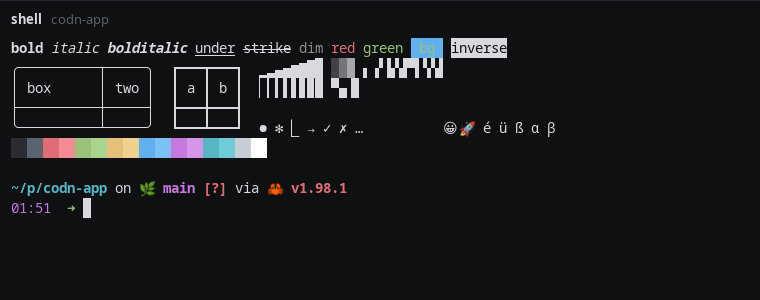

<h1>
  <picture>
    <source media="(prefers-color-scheme: dark)" srcset="assets/logo-white.svg">
    
  </picture>
</h1>

**A native Linux app for running terminal coding agents.**

Claude Code, Codex, opencode and a plain shell, each in a real terminal of its own,
grouped by project in a sidebar. Each session carries a mark that says
whether it is working, waiting for you or done. Beside it: what changed in
the project, or one of its files.

In the picture every session is a shell that reports, as any program can,
what it is doing, what it runs with and which agents it sent off.

## No API key

A session is the agent's own command line program, unmodified, on a
terminal. codn talks to no model API and never sees a token: you log in to
`claude`, `codex` or `opencode` as you always do, and your subscription works
as it does in any other terminal. Any other CLI is a few lines of configuration.

## What it does

- **Projects and sessions** in a sidebar, restored after a restart. Claude
  Code continues its conversation, and so does opencode with its plugin, and
  a Codex conversation chosen from the history.
- **What every session is doing**, as a mark of its own shape: at rest,
  working, waiting for you, done, failed. A desktop notification says when
  a session you are not looking at needs you, and what for.
- **Earlier conversations** of a project, found where the agents keep them
  and continued with a click, whether they were started in codn or not.
- **The agents a session sends off**, as rows below it, each with what it
  is doing now.
- **A bar along the bottom** with what the agent in front reports about
  itself: the model, its speed in tokens a second, how full the context
  is and how much of the limits is used.
- **Two sessions side by side.**
- **The changes of a project**, as a diff of everything that changed,
  new files included.
- **The files of a project** in a column that folds away. A file opens
  beside a session, in the colors of its language and with what changed
  since the last commit, and can be changed and saved there. Markdown is
  shown as it is meant, a PNG or a JPEG as a picture.
- **An address in a terminal**, opened in your browser with Ctrl and a
  click.

## Build

    cargo build --release
    ./target/release/codn ~/code/my-project

Needs Rust 1.91 or newer, and no system development packages. At run time
codn uses OpenGL 3.3 or OpenGL ES 3.0, fontconfig, `git`, and where they
are there `notify-send` and `xdg-open`. It runs on Wayland and on X11.

To find codn in the application menu, with its icon in the task bar:

    install -Dm755 target/release/codn ~/.local/bin/codn
    install -Dm644 assets/codn.desktop ~/.local/share/applications/codn.desktop
    install -Dm644 assets/icon.svg ~/.local/share/icons/hicolor/scalable/apps/codn.svg

The desktop entry starts `codn` by its name. Where `~/.local/bin` is not in
the search path of your desktop, write the whole path behind `Exec=` in
your copy of the entry.

How to use it, what fills the bar and how to configure it is in the
[manual](MANUAL.md).

## In numbers

| | |
| --- | --- |
| First frame | 32 ms after the process starts |
| A key, to the frame that shows it | 0.65 ms, the median, from the key reaching codn to the frame handed to the compositor |
| At rest | no CPU, and not one system call in a minute, with a shell session open |
| Memory | 20 MiB of its own with a shell session open. The rest of a resident set of 110 MB is shared libraries, most of them the GPU driver |
| Binary | about 8 MB, linked against libc, libm and libgcc alone |
| Code | 42,681 lines of Rust, 516 tests |
| Dependencies | 15 crates, each named in `Cargo.toml` with why it is there |

Measured with the release build of 0.3.0 on an i7-12700K with a GeForce
GTX 980, under Wayland, in a compositor without a screen:
`scripts/measure.sh` takes the times, the CPU and the memory, and the idle
minute was watched with `strace -f`.

## How it is built

- **One process, one window, one draw call.** Everything on the screen is
  a quad: rectangles, glyphs from an atlas, box-drawing characters as
  geometry.

  

- **Drawn only when something changed.** Nothing runs on a timer while
  the window rests.
- **Foreign parsers run apart.** The colors of a file, Markdown and
  pictures are worked out by codn started a second time, as a process of
  its own with a bound on its memory and its time. A file made to break
  a parser ends that process, not codn and not your sessions.
- **The terminal emulator is not ours.** `alacritty_terminal` parses and
  keeps the state of a terminal, with small patches under `vendor/`,
  each said in a `PATCHES.md`.
- **Icons drawn for their size.** The few drawings are
  [Codicons](https://github.com/microsoft/vscode-codicons), by Microsoft
  under CC BY 4.0, made for 16 pixels.

## Status

Early. Version 0.3 is used every day by its author on Arch Linux with KDE
Plasma (Wayland, NVIDIA), and tested on plain X11. Linux only, and no
packages yet: you build it yourself. It is usable, and it is not finished.

## Not there yet

- Themes and a light mode
- Search in scrollback, links a program marks itself (OSC 8), and a
  file with its line (`src/main.rs:42`) opened by a click
- Input method preedit (committed text works)
- Window shadow and rounded window corners
- Reordering of projects and sessions
- Touch input
- A structured, non-terminal view of agent conversations
- A worktree per session
- Finding text in a file, and keys that move through the column with the
  files
- A progressive JPEG and other kinds of pictures, and in a file of
  Markdown its pictures and links that lead somewhere
- Projects on another machine
- Packages, and any system but Linux

## Changes and license

What changed from one version to the next is in [CHANGELOG.md](CHANGELOG.md).

codn is licensed under either of the [Apache License, Version 2.0](LICENSE-APACHE)
or the [MIT license](LICENSE-MIT), at your option. The patched crates under
`vendor/` keep their own licenses, which lie beside them, and so do the
grammars under `assets/syntax/`: `SOURCES.md` there names each.

## Trademarks

codn is not affiliated with, endorsed by or sponsored by Anthropic, OpenAI
or the makers of opencode. Claude and Claude Code are trademarks of Anthropic, and OpenAI and
Codex are trademarks of OpenAI. codn names them only to say which program
a session runs, and shows no logo of any of them.
